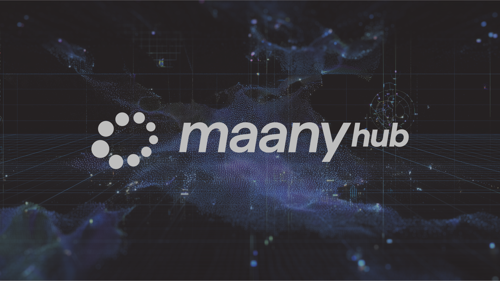

# Maany-Hub



[](https://www.repostatus.org/#active)
[](https://github.com/cosmos/gaia/blob/main/LICENSE)
[](https://github.com/maany-xyz/maany-provider/latest)
<!-- [](https://goreportcard.com/report/github.com/cosmos/gaia) -->
<!-- [](https://pkg.go.dev/github.com/cosmos/gaia) -->
<!-- [](https://sonarcloud.io/summary/new_code?id=cosmos_gaia) -->
<!-- [](https://sonarcloud.io/summary/new_code?id=cosmos_gaia) -->
<!-- [](https://sonarcloud.io/summary/new_code?id=cosmos_gaia) -->
<!-- [](https://x.com/cosmoshub)
[](https://discord.gg/interchain)
[](https://forum.cosmos.network) -->

<h1 align="center">Maany Provider Chain</h1>

<p align="center">
  <b>The Core Layer of the Maany Blockchain Ecosystem</b><br>
  Securing and coordinating every Maany zone through delegated Proof of Stake and interchain security.
</p>

---

## 🌍 Overview

**Maany Provider** is the foundational blockchain of the **Maany ecosystem**, built with the [Cosmos SDK](https://docs.cosmos.network/).  
It serves as the **main hub** that secures, validates, and economically anchors all connected **Maany consumer chains**, including:

- 🪙 **Maany DEX** — the decentralized exchange consumer chain.  
- 🧩 **Maany App Chains** — individual app-specific subnets created via the Integration Framework.  

The Provider chain is responsible for:
- Staking, validator management, and governance.
- Escrow-based cross-chain minting (`x/mintburn`).
- Block reward distribution and ecosystem wallet logic.
- Chain registration, interchain security, and ICS management.

---

## ⚙️ Modules

| Module | Purpose |
|---------|----------|
| **x/mintburn** | Handles escrow and mint logic for mirrored tokens on consumer chains. |
| **x/blockrewards** | Manages validator and ecosystem reward emissions. |
| **x/autolp / x/buyback** *(consumer-side)* | Complementary modules interacting with provider policy and rewards. |

---

## 🧩 Architecture

```text
          ┌──────────────────────────┐
          │      Maany Provider      │
          │  (Delegated PoS Hub)     │
          └────────────┬─────────────┘
                       │  Interchain Security (ICS)
                       ▼
     ┌─────────────────────────────┬─────────────────────────────┐
     │        Maany DEX            │         Maany App Chains    │
     │ (Liquidity + Price Engine)  │  (Tokenized Web2 dApps)     │
     └─────────────────────────────┴─────────────────────────────┘
